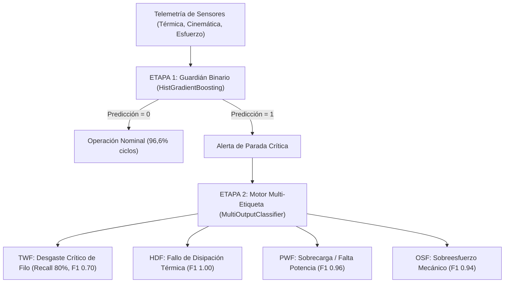

# Pipeline Industrial de Mantenimiento Predictivo (AI4I 2020)

[](https://www.python.org/)
[](https://scikit-learn.org/)
[](LICENSE)

Pipeline integral de Machine Learning industrial y diagnóstico prescriptivo en dos etapas (*Two-Stage Pipeline*) desarrollado sobre el dataset **AI4I 2020 Predictive Maintenance Dataset** (UC Irvine / Stephan Matzka). 

El proyecto resuelve la anticipación al fallo en centros de mecanizado CNC mediante **ingeniería de variables físicas**, evaluación comparativa estricta supervisada vs. no supervisada (detección de anomalías), calibración de umbrales por matriz de costes de planta y diagnóstico prescriptivo multi-etiqueta desacoplado.

---

## 🎯 Arquitectura del Pipeline

El sistema desacopla la detección en tiempo real del diagnóstico de componentes mecánicos:



- **Fase 1 (Detección Binaria):** Clasificador de gradiente boosting por histogramas (`HistGradientBoostingClassifier(class_weight='balanced')`) optimizado sobre la métrica **PR-AUC** para mitigar el desbalance severo (3,39 % de paradas reales).
- **Fase 2 (Diagnóstico Prescriptivo Multi-Etiqueta):** Motor especialista que solo se activa sobre máquinas en parada para diagnosticar la causa física raíz (TWF, HDF, PWF, OSF) mediante *Binary Relevance* y umbrales adaptativos calibrados por validación cruzada (`TunedThresholdClassifierCV`).

---

## ⚙️ Ingeniería de Características (Fundamento Físico)

En lugar de delegar el aprendizaje en telemetría en bruto, se modelaron analíticamente las magnitudes físicas que gobiernan la rotura en mecanizado:

1. **Diferencial Térmico ($\Delta T$):**
   $$\Delta T = T_{\text{process}} - T_{\text{air}}$$
   Aísla la eficiencia de disipación térmica del refrigerante, eliminando la correlación espuria con la temperatura ambiental estacional ($r = 0{,}87$).
2. **Potencia Mecánica Neta ($P_{\text{mech}}$):**
   $$P_{\text{mech}} = \tau \cdot \omega = \tau \cdot \left(\text{RPM} \cdot \frac{2\pi}{60}\right) \quad [\text{W}]$$
   Combina par torsor y régimen de giro en una magnitud energética escalar que detecta regímenes fuera de catálogo ($< 3.500\,\text{W}$ o $> 9.000\,\text{W}$).
3. **Factor de Sobreesfuerzo ($\text{strain\_factor}$):**
   $$\text{strain\_factor} = \text{Torque} \times \text{Tool wear}$$
   Modela la fatiga acumulada en filo de corte bajo tensión torsional, discriminando según los umbrales de rotura por variante de calidad (L, M, H).
4. **Protocolo Anti-Leakage:** Exclusión estricta de variables de fuga (`UDI`, `Product ID` y los 5 modos de fallo específicos en la Fase 1).

---

## 📊 Resultados y Validación Empírica

### 1. Benchmark Fase 1: 5-Fold Stratified Cross-Validation (Train $N=8.000$)

| Familia | Modelo | PR-AUC (Mean ± Std) | ROC-AUC | F1-Score |
| :--- | :--- | :---: | :---: | :---: |
| **Ensamble Boosting** | **HistGradientBoosting** | **0.8875 ± 0.0176** | **0.9821** | **0.859** |
| Ensamble Bagging | Random Forest | 0.8811 ± 0.0290 | 0.9804 | 0.840 |
| Árbol Individual | Decision Tree | 0.8018 ± 0.0631 | 0.8887 | 0.540 |
| Modelo Lineal | Logistic Regression | 0.4501 ± 0.0417 | 0.9254 | 0.276 |

> **Evaluación en Holdout Ciego de Test ($N=2.000$, 68 fallos):**  
> `HistGradientBoosting` alcanzó **PR-AUC = 0.9150**, **Recall = 83.8 %**, **Precision = 95.0 %** y **F1 = 0.891**.

### 2. El Hallazgo Causal: ¿Por qué fracasa la Detección No Supervisada?
Los métodos de detección de anomalías espaciales (**Isolation Forest**, **One-Class SVM**, **LOF**) colapsaron con un **PR-AUC máximo de 0.2584**. 
- **La Paradoja de la Densidad Nominal:** La fatiga mecánica y el desgaste progresivo de la herramienta ocurren dentro de rangos normales de velocidad, par y temperatura. Por tanto, las roturas comparten el núcleo denso del espacio euclídeo y no constituyen *outliers* espaciales.

### 3. Fase 2: Diagnóstico Prescriptivo Multi-Etiqueta ($N_{\text{test\_fail}} = 68$)

Al desacoplar el diagnóstico y evaluar exclusivamente sobre las incidencias activas:

| Modo de Fallo | Soporte Real | PR-AUC | Precision | Recall | F1-Score | Causa Mecánica Directa |
| :--- | :---: | :---: | :---: | :---: | :---: | :--- |
| **HDF (Térmico)** | 29 | **1.0000** | 100.0 % | 100.0 % | **1.00** | $\Delta T < 8{,}6\,\text{K} \land \text{RPM} < 1.380$ |
| **PWF (Potencia)** | 13 | **1.0000** | 92.9 % | 100.0 % | **0.96** | $P_{\text{mech}} < 3.500\,\text{W} \lor > 9.000\,\text{W}$ |
| **OSF (Sobreesfuerzo)** | 16 | **0.9819** | 88.9 % | 100.0 % | **0.94** | $\text{Torque} \times \text{Tool wear} > \text{Límite}$ |
| **TWF (Desgaste Filo)** | 10 | **0.8385** | 61.5 % | **80.0 %** | **0.70** | Desgaste crítico $[200 - 240\,\text{min}]$ |

---

## 📁 Estructura del Repositorio

```text
Predictive-Maintenance-AI4I-2020/
├── data/
│   └── ai4i2020.csv                       # Dataset industrial original (10.000 ciclos)
├── notebooks/
│   └── pipeline_entrega.ipynb             # Notebook ejecutable con análisis y visualizaciones
├── src/
│   ├── __init__.py
│   ├── features.py                        # Pipeline de ingeniería de características físicas
│   └── models.py                          # Benchmark CV, Detección anomalías y Diagnóstico
├── PIPELINE DE MACHINE LEARNING...pdf      # Informe técnico ejecutivo en PDF
├── Entrega_Caso_Practico_2_ML_Pipeline.zip # Paquete de entrega compilado
└── README.md                              # Documentación del proyecto
```

---

## 🚀 Instalación y Reproducción

### 1. Clonar el repositorio
```bash
git clone https://github.com/tu-usuario/Predictive-Maintenance-AI4I-2020.git
cd Predictive-Maintenance-AI4I-2020
```

### 2. Crear entorno virtual e instalar dependencias
Recomendado con `uv` o `venv`:

```bash
# Con uv (rápido):
uv venv
uv pip install -r requirements.txt # o dependencias principales

# O con python estándar:
python -m venv .venv
source .venv/bin/activate  # En Linux/Mac
# .venv\Scripts\Activate.ps1  # En Windows
pip install numpy pandas scikit-learn matplotlib seaborn jupyter
```

### 3. Ejecutar el Notebook
```bash
jupyter notebook notebooks/pipeline_entrega.ipynb
```

---

## 🏭 Hoja de Ruta para Despliegue en Planta

1. **Microservicio en Streaming:** Empaquetar `IndustrialFeatureEngineer` + los modelos serializados en una API de baja latencia conectada al bus de eventos de la máquina (MQTT / OPC-UA).
2. **Explicabilidad Local:** Visualizaciones tipo SHAP/Waterflow en el SCADA del operario para justificar la orden de intervención.
3. **Control de Data Drift:** Monitorización continua de derivas en $P_{\text{mech}}$ y $\Delta T$ ante cambios de aleación de material o sustitución de husillos.
