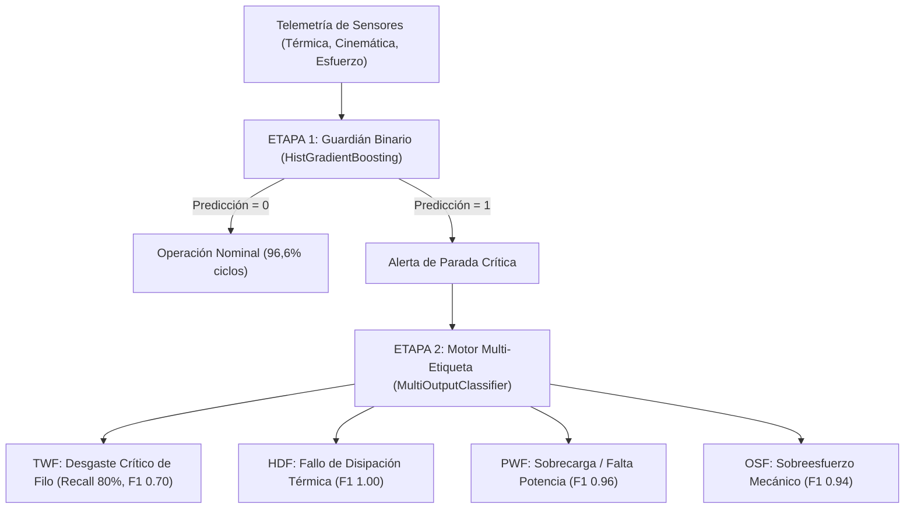

# Pipeline Industrial de Mantenimiento Predictivo (AI4I 2020)

[](https://www.python.org/)
[](https://docs.astral.sh/uv/)
[](https://scikit-learn.org/)
[](LICENSE)

Pipeline integral de Machine Learning industrial y diagnóstico prescriptivo en dos etapas (*Two-Stage Pipeline*) desarrollado sobre el dataset **AI4I 2020 Predictive Maintenance Dataset** (UCI Machine Learning Repository)[cite: 1].

El proyecto resuelve la anticipación al fallo en centros de mecanizado CNC mediante **ingeniería de variables físicas**, evaluación comparativa estricta entre modelos supervisados y detección de anomalías, y diagnóstico prescriptivo multi-etiqueta desacoplado con calibración automática de umbrales[cite: 1].

---

## 🎯 Arquitectura del Pipeline

El sistema desacopla la detección binaria de paradas del diagnóstico de componentes mecánicos[cite: 1]:



- **Fase 1 (Detección Binaria):** Clasificador de gradiente boosting por histogramas (`HistGradientBoostingClassifier(class_weight="balanced")`) evaluado sobre **PR-AUC** para mitigar el desbalance severo (3,39 % de paradas reales)[cite: 1].
- **Fase 2 (Diagnóstico Prescriptivo Multi-Etiqueta):** Motor especialista activado exclusivamente sobre incidencias activas para identificar la causa raíz (`TWF`, `HDF`, `PWF`, `OSF`) mediante *Binary Relevance* y ajuste de umbrales por validación cruzada (`TunedThresholdClassifierCV`)[cite: 1].

---

## ⚙️ Ingeniería de Características (Fundamento Físico)

En lugar de delegar el aprendizaje en telemetría en bruto, se formularon analíticamente las magnitudes físicas que gobiernan la rotura en mecanizado[cite: 1]:

**1. Diferencial Térmico ($\Delta T$)**

```math
\Delta T = T_{\text{process}} - T_{\text{air}}
```

Aísla la eficiencia de disipación térmica del refrigerante, eliminando la colinealidad con la temperatura ambiental estacional ($r = 0{,}88$)[cite: 1, 2].

**2. Potencia Mecánica Neta ($P_{\text{mech}}$)**

```math
P_{\text{mech}} = \tau \cdot \omega = \tau \cdot \left(\text{RPM} \cdot \frac{2\pi}{60}\right) \quad [\text{W}]
```

Combina par torsor y régimen de giro en una magnitud energética escalar que detecta regímenes fuera de catálogo ($< 3.500\text{ W}$ o $> 9.000\text{ W}$)[cite: 1, 3].

**3. Factor de Sobreesfuerzo (`strain_factor`)**

```math
\text{Strain Factor} = \text{Torque} \times \text{Tool wear}
```

Modela la fatiga acumulada en el filo de corte bajo tensión torsional, discriminando según los límites de rotura por variante de calidad (`L`, `M`, `H`)[cite: 1].

**4. Protocolo Anti-Leakage**  
Exclusión estricta de identificadores (`UDI`, `Product ID`) y de los 5 indicadores de diagnóstico específico (`TWF`, `HDF`, `PWF`, `OSF`, `RNF`) durante el entrenamiento de la Fase 1[cite: 1].

---

## 📊 Resultados y Validación Empírica

### 1. Benchmark Fase 1: 5-Fold Stratified Cross-Validation (Train: 8.000 ciclos)

| Familia | Modelo | PR-AUC (Mean ± Std) | ROC-AUC | F1-Score |
| :--- | :--- | :---: | :---: | :---: |
| **Ensamble Boosting** | **HistGradientBoosting** | **0.8875 ± 0.0176** | **0.9821** | **0.859** |
| Ensamble Bagging | Random Forest | 0.8811 ± 0.0290 | 0.9804 | 0.840 |
| Árbol Individual | Decision Tree | 0.8018 ± 0.0631 | 0.8887 | 0.540 |
| Modelo Lineal | Logistic Regression | 0.4501 ± 0.0417 | 0.9254 | 0.276 |

> **Evaluación en Holdout Ciego de Test ($N = 2.000$, 68 fallos reales):**  
> `HistGradientBoosting` alcanzó **PR-AUC = 0.9150**, **Recall = 83.8 %**, **Precision = 95.0 %** y **F1 = 0.891**.

### 2. El Hallazgo Causal: ¿Por qué fracasa la Detección No Supervisada?

Los métodos de detección de anomalías espaciales (**Isolation Forest**, **One-Class SVM**, **LOF**) colapsaron con un **PR-AUC máximo de 0.2584**[cite: 1].
- **La Paradoja de la Densidad Nominal:** La fatiga mecánica y el desgaste progresivo de la herramienta ocurren dentro de rangos normales de velocidad, par y temperatura[cite: 1]. Por tanto, las roturas comparten el núcleo denso del espacio de sensores y no constituyen *outliers* geométricos[cite: 1].

### 3. Fase 2: Diagnóstico Prescriptivo Multi-Etiqueta (Subconjunto de Fallos: 68 ciclos)

Al desacoplar el diagnóstico y evaluar exclusivamente sobre las máquinas en estado de parada:

| Modo de Fallo | Soporte Real | PR-AUC | Precision | Recall | F1-Score | Causa Mecánica Directa |
| :--- | :---: | :---: | :---: | :---: | :---: | :--- |
| **HDF (Térmico)** | 29 | **1.0000** | 100.0 % | 100.0 % | **1.00** | $\Delta T < 8{,}6\text{ K}$ y $\text{RPM} < 1.380$[cite: 3] |
| **PWF (Potencia)** | 13 | **1.0000** | 92.9 % | 100.0 % | **0.96** | $P_{\text{mech}} < 3.500\text{ W}$ o $> 9.000\text{ W}$[cite: 3] |
| **OSF (Sobreesfuerzo)** | 16 | **0.9819** | 88.9 % | 100.0 % | **0.94** | $\text{Torque} \times \text{Tool wear} > \text{Límite}$[cite: 3] |
| **TWF (Desgaste Filo)** | 10 | **0.8385** | 61.5 % | **80.0 %** | **0.70** | Desgaste crítico ($200 - 240\text{ min}$) |

---

## 📁 Estructura del Repositorio

```text
Predictive-Maintenance-AI4I-2020/
├── data/
│   └── ai4i2020.csv                # Dataset industrial original (10.000 ciclos)[cite: 1]
├── notebooks/
│   └── pipeline_entrega.ipynb      # Notebook ejecutable con EDA, modelado y gráficos[cite: 1]
├── src/
│   ├── __init__.py[cite: 1]
│   ├── features.py                 # Transformador reproducible de ingeniería física[cite: 1]
│   └── models.py                   # Benchmark CV, detección de anomalías y diagnóstico[cite: 1]
├── main.py                         # Punto de entrada de ejecución del pipeline[cite: 1]
├── pyproject.toml                  # Definición del proyecto y dependencias[cite: 1]
├── uv.lock                         # Lockfile determinista de paquetes[cite: 1]
└── README.md                       # Documentación técnica del proyecto[cite: 1]
```

---

## 🚀 Instalación y Reproducción

Este proyecto utiliza **[uv](https://docs.astral.sh/uv/)** para garantizar una resolución determinista y ultrarrápida del entorno en **Python 3.14**[cite: 1].

### 1. Clonar el repositorio
```bash
git clone https://github.com/ArturoCarrilloJimenez/Predictive-Maintenance-AI4I-2020.git
cd Predictive-Maintenance-AI4I-2020
```

### 2. Sincronizar el entorno virtual
```bash
uv sync
```

### 3. Ejecutar el pipeline o abrir el notebook
```bash
# Ejecutar el script principal:
uv run python main.py

# O lanzar Jupyter para explorar el análisis completo:
uv run jupyter notebook notebooks/pipeline_entrega.ipynb
```

---

## 🏭 Hoja de Ruta para Despliegue en Producción

1. **Microservicio en Tiempo Real:** Empaquetar `IndustrialFeatureEngineer` junto con los modelos serializados en una API de baja latencia conectada al flujo de telemetría de la fresadora, ejecutando la Etapa 2 únicamente bajo demanda tras una alerta de la Etapa 1[cite: 1].
2. **Explicabilidad Local para el Operario:** Integrar gráficos explicativos (como valores SHAP / *Waterfall*) en el panel de mantenimiento para mostrar al técnico qué sensor exacto disparó la predicción en ese ciclo.
3. **Control de *Data Drift* y Reentrenamiento:** Monitorizar las distribuciones de `mechanical_power_w` y `temp_diff_k` ante cambios de material mecanizado (ej. aluminio frente a acero templado) para activar reentrenamientos periódicos[cite: 1].
4. **Sensorización Complementaria:** Incorporar sensores de vibración y sonido en el cabezal para mejorar la detección temprana del desgaste progresivo (`TWF`) y capturar anomalías actualmente no instrumentadas (`RNF`)[cite: 1].
